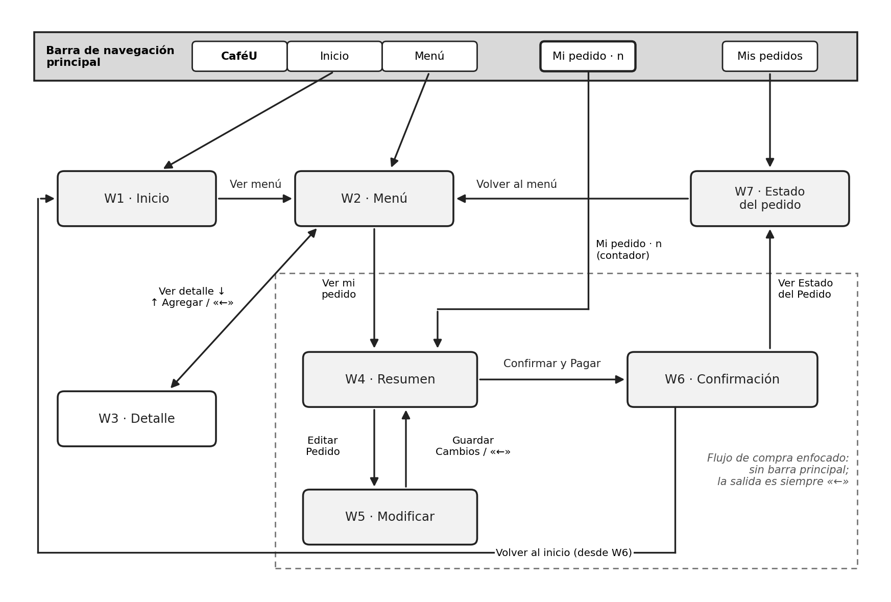

# 04 · Esquema de navegación e inventario de componentes — CaféU

## Menú principal y mecanismos de navegación

| Mecanismo | Dónde aparece | Función | Por qué facilita la interacción |
|---|---|---|---|
| Barra de navegación principal (CaféU · Inicio · Menú · Mis pedidos · Mi pedido · n) | W1, W2, W7 | Acceso directo a las secciones de nivel 1. | Siempre visible y en el mismo lugar; el contador de «Mi pedido» muestra el estado del pedido sin abrirlo. |
| Botón «←» en el encabezado | W3, W4, W5 | Volver a la pantalla anterior. | Salida clara en el flujo de compra; en W5 pregunta antes de descartar cambios. |
| Botón principal (relleno) | Todas | La acción esperada: «Ver menú», «Agregar al pedido», «Confirmar y Pagar», «Guardar Cambios», «Ver Estado del Pedido». | Una sola acción destacada por pantalla reduce la duda sobre qué hacer (ley de Hick). |
| Botón secundario (borde) | W2, W4, W7 | Alternativas: «Ver detalle», «Editar Pedido», «Volver al menú». | Diferencia visual entre la acción principal y la alternativa. |
| Barra fija «Ver mi pedido» | W2 (con productos) | Llevar al resumen sin buscar el botón. | Muestra cantidad y total mientras se sigue comprando. |
| Enlace «Volver al inicio» | W6 | Cerrar el flujo de compra. | Evita callejones sin salida después de pagar. |
| Flujo de compra enfocado | W4, W5, W6 | Oculta la barra principal durante la revisión y el pago. | Menos distracciones y menos riesgo de abandonar el pedido a medio camino. |

## Inventario de componentes reutilizables

| Componente | Descripción | Pantallas | Principio aplicado |
|---|---|---|---|
| Barra de navegación | Marca + 3 enlaces + botón «Mi pedido · n». | W1, W2, W7 | Consistencia; visibilidad del estado |
| Encabezado con «←» | Título centrado y botón para volver. | W3, W4, W5 | Control y libertad del usuario |
| Botón principal / secundario | Relleno oscuro para la acción esperada; borde para la alternativa; gris si está desactivado. | Todas | Jerarquía visual; prevención de errores |
| Campo de búsqueda | Entrada de texto con indicación «Buscar producto…». | W2 | Reconocer antes que recordar |
| Filtros (chips) | Todo · Bebidas · Comida; el activo va relleno. | W2 | Reducción de la carga cognitiva |
| Tarjeta de producto | Imagen, nombre, descripción, precio, etiqueta «AGOTADO» y «Ver detalle». | W2 | Agrupación (proximidad) |
| Tarjeta de resumen | Lista de productos con cantidad y precio, y total en negrita. | W4, W6 | Visibilidad del estado |
| Selector de cantidad | «−» número «+», con áreas táctiles de 36 px o más. | W3, W5 | Ley de Fitts; prevención de errores (mínimo 1) |
| Icono de basurero | Elimina un producto del pedido. | W5 | Control del usuario |
| Diálogo de confirmación | «¿Eliminar…?» y «¿Descartar los cambios?» con «Cancelar» y la acción. | W5 | Prevención de errores |
| Mensaje de estado | Éxito (✓), error (!) y vacío, con texto y una salida. | W3, W4, W5, W6 | Ayuda a reconocer y recuperarse de errores |
| Indicador de pasos | Recibido → En preparación → Listo para retirar. | W7 | Visibilidad del estado del sistema |
| Aviso emergente (toast) | «Agregado a tu pedido», «Cambios guardados». | W2, W4 | Retroalimentación inmediata |
